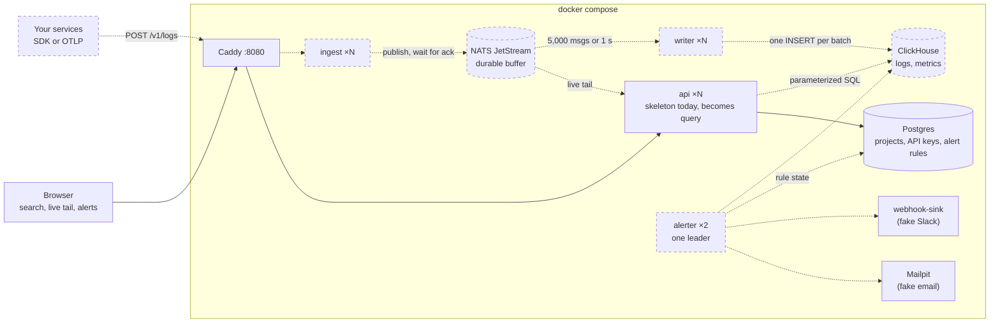

# Logs and metrics

A self-hosted log and metrics pipeline: ingest, store, search, and alert.

The step-by-step build plan is in [PLAN.md](PLAN.md).

> **Status:** skeleton. The stack runs, scales and passes CI. The product itself isn't built yet.

## Run it

```bash
git clone --recurse-submodules https://github.com/gonzalo-gigena/observability.git
cd observability
cp .env.example .env
docker compose up --watch
```

Open http://localhost:8080. Needs only Docker with Compose v2. Code changes reload
automatically (Compose Watch). On Windows, clone inside the WSL filesystem, not `/mnt/c`.

Cloned without `--recurse-submodules`? Run `git submodule update --init`.

## Everyday commands

| What | Command |
|---|---|
| Seed demo data | `docker compose run --rm seed` |
| SQL shell | `docker compose exec db psql -U app app` |
| Scale the api | `docker compose up -d --scale api=3` |
| Prove scaling works | `sh common/scripts/smoke.sh 3` |
| Run exactly what CI runs | `sh common/scripts/ci-stack.sh 3` |
| Load test at 1, 2, 4 replicas | `sh common/scripts/scale.sh` |
| Metrics (Prometheus) | `docker compose --profile observability up -d`, then http://localhost:9090 |
| Unit tests | `docker run --rm -v "$PWD/apps/api:/src" -w /src golang:1.27.4-bookworm sh -c "go vet ./... && go test ./..."` |
| New migration | add `infra/db/migrations/00000N_name.up.sql` + `.down.sql`, restart |
| Update shared code | `git submodule update --remote common` |
| Reset everything | `docker compose down -v` |

## Fakes (from common)

These start in dev and CI (`COMPOSE_PROFILES=fakes`), never in production.
Full reference: [`common/README.md`](common/README.md).

| Service | What |
|---|---|
| `webhook-sink` | Records webhooks sent to `http://webhook-sink:8091/hooks/<name>`. View at http://localhost:8091. |
| `mailpit` | Catches all email. Send to `smtp://mailpit:1025`, read at http://localhost:8025. |

## Architecture



Solid boxes and arrows run today. Dashed ones are planned in [PLAN.md](PLAN.md).

`ingest` never touches ClickHouse. JetStream absorbs bursts, and `writer` drains it in large batches at the rate ClickHouse handles well.

## Stack

- **api:** Go 1.27 (`net/http` + `pgx` + Prometheus client), distroless runtime image. Stateless, so it scales with `--scale api=N`.
- **Caddy:** the only service with a host port. It load-balances `/api/*` across every
  replica (`import lb api 8080`, from common) and serves `apps/web`.
- **Postgres 18:** migrations run once before the api starts (`golang-migrate`).
- **common/:** git submodule with the shared fakes, scripts, Caddy snippet and Prometheus.
  See [portfolio-common](common/README.md).

## Deploy (one VM)

```bash
docker compose -f compose.yaml -f compose.prod.yaml up -d
```

The server's `.env` needs `SITE_ADDRESS`, `IMAGE_REPO`, `TAG`, a strong password, and no `fakes`
profile. Caddy gets TLS automatically. CI pushes multi-arch images to GHCR on every merge to `main`.

## Decisions & tradeoffs

| Decision | Chosen | Rejected | Why, and what it costs |
|---|---|---|---|
| Buffer between ingest and storage | NATS JetStream | Kafka, or writing straight to ClickHouse | Decouples burst rate from insert rate, with one small binary instead of a Kafka cluster. Cost: one more stateful service, and JetStream fsyncs periodically, so "no loss" covers process crashes, not power loss. |
| Backpressure | Stream `max_bytes` with `discard: new`. ingest answers 503 with `Retry-After`, and the SDK retries from a bounded buffer | The default, `discard: old` | `discard: old` silently deletes the oldest data when the stream is full. Rejecting new data is visible and retryable. |
| Storage | ClickHouse `MergeTree`, `ORDER BY (project_id, service, ts)`, daily partitions, 30-day TTL | Postgres, Elasticsearch | Columnar and compressed, built for append-heavy, scan-heavy data. `project_id` first keeps each tenant's queries inside its own ranges. Cost: it wants big batches, and updates or deletes are expensive. |
| Inserts | Batches of 5,000 messages or 1 s. Ack only after the insert succeeds | Row-by-row inserts | Each insert creates a part, and many small inserts end in "too many parts". A failed insert isn't acked, so JetStream redelivers it. |
| Duplicates on redelivery | To decide in phase 2: deterministic batches from sequence ranges with an insert dedup token, or `ReplacingMergeTree` keyed by `id` | A random batch ID as the dedup token | A redelivered batch may hold different messages than the first try, so a random token doesn't dedupe anything. |
| Query language | Hand-written tokenizer → AST → parameterized SQL. Every query must include `project_id` and a time range | Accepting raw SQL, or building SQL strings | No injection by construction, and one tenant can't scan everyone's data or the whole table. |
| Alerting | Evaluator runs only on the leader (`pg_try_advisory_lock`). State machine `ok → pending → firing → resolved` in Postgres. Notify on transitions, retry through an outbox | Notifying on every evaluation | Transitions dedupe alerts for free, and the outbox survives a crash between changing state and sending. |
| Alert targets in dev and CI | `webhook-sink` and Mailpit from `common/` | A real Slack workspace | Runs offline, and tests can read exactly what was sent. |
| Load balancing | Caddy `dynamic a` upstreams (the `lb` snippet in `common/`) | `reverse_proxy api:8080`, Traefik | Caddy re-reads Docker DNS every 5 s, so `--scale api=N` needs no config change and no Docker socket mount. A plain `reverse_proxy api:8080` is a single upstream to Caddy and doesn't reliably spread load. |
| Migrations | A one-shot `migrate` service that finishes before the api starts | Each replica migrating on boot | Replicas starting together would race on the same migration. |

Rows for parts that aren't built yet record the plan's choice. Each one gets confirmed or revised when that phase is built.

## Scaling

### Measured

The skeleton only, not the product yet: k6 with 20 virtual users for 20 s against `GET /api/hello`, which reads one row from Postgres through Caddy. Run on an Apple M1 laptop with 8 CPUs and 8 GB given to Docker, with the dev override left out:

```bash
COMPOSE_FILE=compose.yaml sh common/scripts/scale.sh
```

| api replicas | req/s | p95 latency | failed |
|---|---|---|---|
| 1 | 17,689 | 2.22 ms | 0.00% |
| 2 | 16,353 | 2.56 ms | 0.00% |
| 4 | 14,937 | 2.96 ms | 0.00% |

4 replicas served 0.8× the requests of 1. One Go process already spreads across every core, and the run shares 8 CPUs with Caddy, Postgres and k6, so on one machine extra api replicas buy redundancy, not throughput. Replica counts matter for `ingest` and `writer`, which phase 7 measures.

### How each part scales

| Part | Scales by | Limit |
|---|---|---|
| `ingest` | `--scale ingest=N` (stateless) | No database on the hot path. API keys are cached for 60 s. |
| `writer` | `--scale writer=N`, one shared pull consumer | ClickHouse insert rate |
| `query` | `--scale query=N` | ClickHouse CPU, bounded by `max_execution_time` and `max_rows_to_read` |
| `alerter` | 2 replicas, one leader | Only the leader evaluates rules |
| JetStream | One node | Disk, capped by `max_bytes` |
| ClickHouse | One node | Insert and scan throughput of one machine |

### Where it breaks next

- **ClickHouse on one node.** Next: a cluster with Keeper, for sharding and replication.
- **JetStream on one node.** Next: a 3-node NATS cluster with replicated streams.
- **Disk.** Move old partitions to S3 with tiered storage.

Phase 7 adds the real test: events/s at 1, 2 and 4 replicas of `ingest` and `writer`, emit-to-searchable latency, and the JetStream backlog during a 2× spike, which should fill and then drain.
